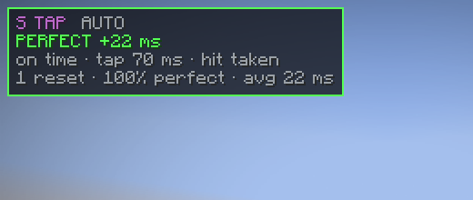
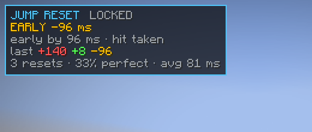

# PVPIsLife Timing

A client-side Fabric mod for **Minecraft 26.x** (built against 26.3, runs on 26.1 – 26.3) that times your
**jump resets**, **W taps** and **S taps** in milliseconds and tells you exactly how much you *missed* the
reset by — or how early you were.

The box lives in the top left corner of the screen and switches to whichever technique you performed last
(you can also lock it to one technique).





```
┌────────────────────────────────────┐
│ JUMP RESET     LOCKED              │  <- technique + AUTO / LOCKED
│ EARLY -96 ms                       │  <- result, green / amber / red
│ early by 96 ms · hit taken         │  <- how far off, in words, + what it was timed against
│ last +140 +8 -96                   │  <- last attempts (signed ms), coloured
│ 3 resets · 33% perfect · avg 81 ms │  <- session summary
└────────────────────────────────────┘
```

Both images above are real screenshots taken by the automated client game test
(`./gradlew runClientGameTest`) running Minecraft 26.3 with the mod loaded.

## What it measures

| Technique | Timed from | Valid when |
| --- | --- | --- |
| **Jump reset** | the moment you press jump on the ground | you pressed jump ≤ 250 ms from a hit you **took** |
| **W tap** | the moment you **release** W | you press W again within 500 ms (a real tap, not just stopping to walk) and a hit is within 250 ms |
| **S tap** | the moment you **press** S | you release S within 500 ms (a long hold is not a tap) and a hit is within 250 ms |

W taps are timed from the **release**, because that is the moment sprint is actually cancelled and the
reset starts; the box also tells you how long you held the tap.

Sign convention:

* `-` = **early**: your reset happened *before* the hit landed
* `+` = **late**: your reset happened *after* the hit landed
* `PERFECT` (green) = inside the perfect window, `EARLY` (amber), `LATE` (red)

Pairing is deliberate: every reset action is held back for 250 ms before it is scored, so a jump you
pressed 90 ms *before* the hit can still be paired with that hit and reported as `EARLY -90 ms`.
The closest hit wins, and one hit can only score one sample per technique.

## Default key binds

| Key | Action |
| --- | --- |
| `[` | toggle the HUD box |
| `]` | cycle the shown technique: `AUTO → JUMP → W TAP → S TAP` |
| `\` | cycle the perfect window: 25 / 50 / 75 / 100 / 150 / 200 ms |
| `R` | reset session stats |

All of them can be rebound in `Options → Controls → Key Binds → PVPIsLife Timing`. `R` is the only default
that can collide with a vanilla bind, so change it if you use it for something else.

## Config

`config/pvpislifemod.json` is written when you change something in game:

```json
{
  "mode": "AUTO",
  "hudEnabled": true,
  "perfectWindowMs": 50.0,
  "showHistory": true,
  "showStats": true,
  "x": 4,
  "y": 4
}
```

`x` / `y` move the box (GUI pixels, top left origin).

## How the timing works

* Hits are taken from `LivingEntity#handleDamageEvent`, the method the client runs when the server sends a
  damage packet for an entity — so a reference hit is recorded the instant your client learns about it,
  both when **you get hit** and when **your hit lands on someone else** (jump resets only pair with hits
  you took, sprint resets pair with both).
* Key transitions are taken from `KeyMapping#setDown`, so presses are timestamped at the exact moment the
  input arrives, not at the next tick. This gives sub-tick precision instead of 50 ms steps.
* Key state changes that come from opening a menu, alt-tabbing or the game re-applying held keys are
  filtered out, so they never create phantom samples.

Because the reference is the moment *your* client received the damage packet, the numbers are exactly the
reaction time you actually had. Jump resets are only scored when you jump from the ground (an air jump does
nothing, so it cannot reset anything).

## Building

```bash
./gradlew build          # jar in build/libs, runs the timing engine self test
./gradlew selfTest       # only the plain-Java engine tests
```

Requires JDK 25. Minecraft 26.x is unobfuscated, so the build uses the non-remapping
`net.fabricmc.fabric-loom` plugin — there are no mappings and no remap step.

## License

MIT
